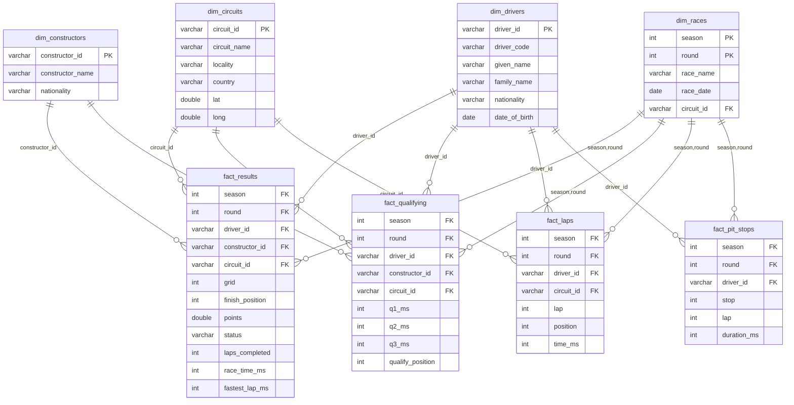
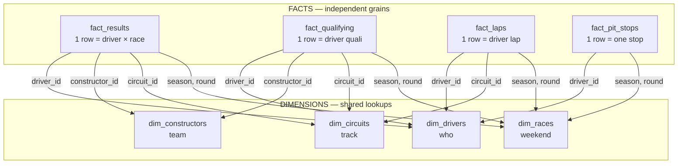
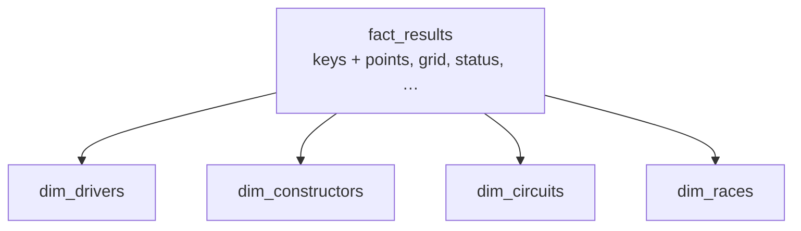

---
aliases:
  - Pitwall Star Schema
  - F1 Star Schema Diagram
tags:
  - olap
  - pitwall
  - schema
---

# Pitwall — Kimball Star Schema (visual)

> Open this note in Obsidian — Mermaid renders below.  
> Static image: ![[pitwall-star-schema.png]]

**Design name:** Kimball dimensional modeling → **star schema**  
**Rule:** facts join dims directly. Facts do **not** depend on each other. Dims are **shared**.

---

## ERD style (entities + keys + relationships)

**How to read the crow’s foot:** `||--o{` means **one** dim row → **many** fact rows (classic star).

---

## Diagram

---

## Same idea as a star (one fact in the middle)

Example for **results only** — the other facts look the same, just different measures/grain:

---

## Remember

| Piece | Role |
| --- | --- |
| **Fact** | What happened (measures / events) |
| **Dim** | Who / what / where labels |
| **Many facts** | Different grains — independent files |
| **Shared dims** | One `dim_drivers` used by all facts |

**Parent:** [[00 OLAP MOC]] · [[OLAP Starter Path — Think OLAP First]]
